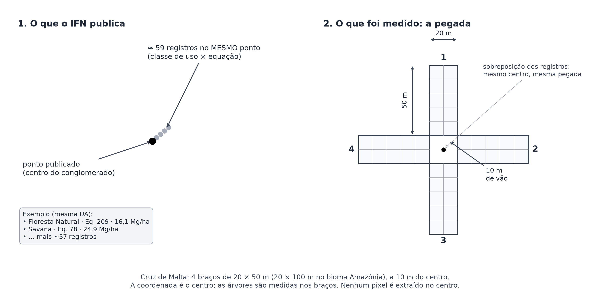
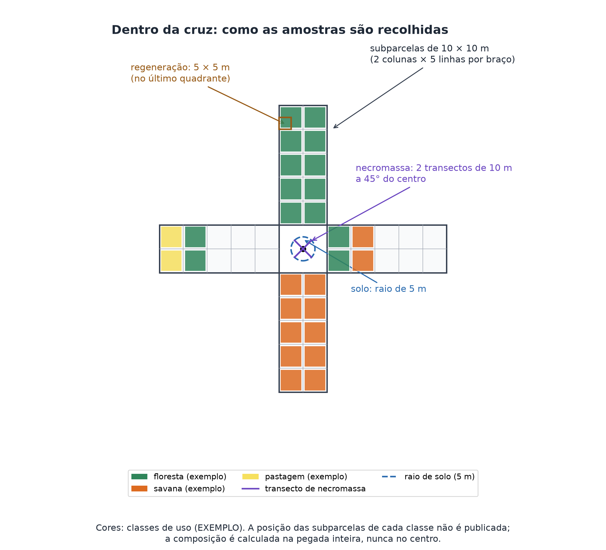
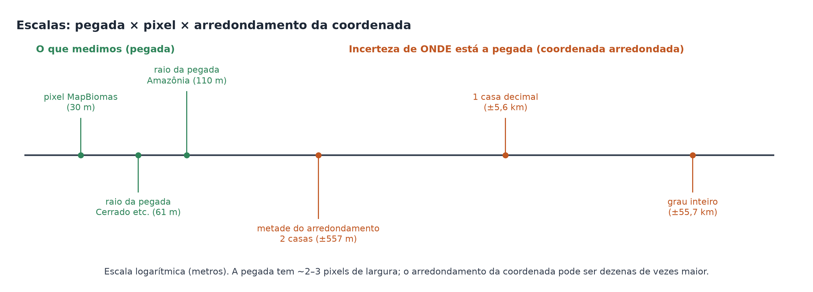
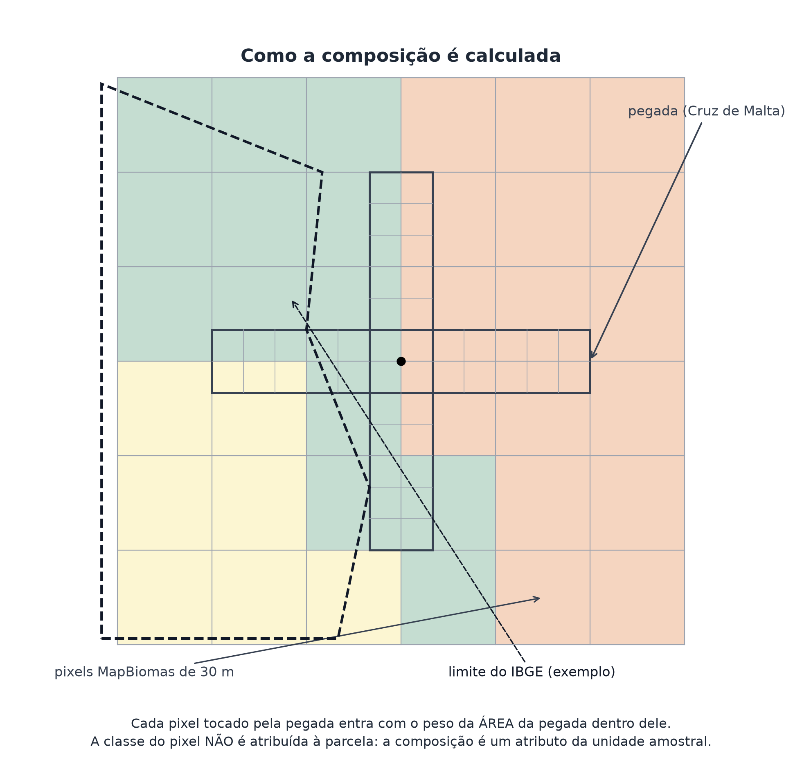

# 60 — Enriquecimento do IFN/SFB com IBGE e MapBiomas (suporte documentado)

**Data:** 2026-11-26 · **Status:** módulo implementado; execução com dados reais e validação
independente registradas nas seções 7 e 8.

Este documento responde ao pedido de pré-processamento do Painel de Biomassa e Carbono
(SFB/IFN) para avaliar quais observações de campo podem alimentar o treino de AGB por
fitofisionomia, preservando medição, origem e unidade observacional.

Artefatos:

| Artefato | Caminho | Papel |
|---|---|---|
| Módulo | `src/biomass_model/enrich_ifn.py` | correspondência, suporte, elegibilidade, validação |
| CLI | `biomass_model.cli ifn-enrich` / `ifn-validate` / `ifn-export` | execução e exportação configuráveis |
| Correspondência IFN→IBGE | `data/reference/ifn_correspondencia_ibge.csv` | temática, com vínculo e fonte |
| Correspondência IBGE→MapBiomas | `data/reference/ibge_legenda1_para_mapbiomas.csv` | por bioma, com evidência da legenda |
| Desenho amostral | `data/reference/ifn_desenho_amostral.csv` | dimensões documentadas do conglomerado |
| Testes | `tests/test_enrich_ifn.py` | contrato, denominadores, elegibilidade, pegada |
| Saídas | `data/processed/ifn_enrich_footprint/` | tabelas e relatórios (gitignored) |

## 1. Auditoria dos arquivos (antes de implementar)

### 1.1 Unidade e cardinalidade

| Arquivo | Grão | Chave | Observação |
|---|---|---|---|
| `pontos_sfb.gpkg` / CSV do painel | UA × classe de uso × equação (439.970 linhas) | `ua` + `classe_uso_da_terra` + `equacoes` | 7.466 UAs; ~59 linhas/UA; a AGB varia por equação (não escolher sem regra) |
| `ua_<UF>.csv` (27 arquivos) | UA (10.201 UAs) | `ua` | município, data de campo, relevo, solo, erosão |
| `vege_area.shp` (IBGE 1:250k) | polígono de vegetação (145.458) | — | `legenda_1` = 13 classes; sem dimensão temporal |
| MapBiomas Col.11 | pixel 30 m (EPSG:4326), 2007–2025 | — | grade idêntica entre anos; uint8 |

### 1.2 Campos candidatos

| Campo | Permite inferir | Fonte documental | Limitação |
|---|---|---|---|
| `ua` | identificador do conglomerado; agrupamento de splits | dicionário do painel | — |
| `bioma`, `uf` | domínio e contexto | dicionário do painel | granularidade estadual |
| `lon_pc`, `lat_pc` | centro do conglomerado (WGS84) | dicionário do painel | **precisão heterogênea** (0–8 casas; 2 casas ≈ 1,1 km) |
| `ua → mun`, `data` | município e **ano de campo** | dicionário “Unidades amostrais por UF” | 457 UAs sem data |
| `tipologia_da_vegetacao` | correspondência temática IBGE | metadados do painel (IBGE 2012; REFLORA 2023) | classificação por informação secundária |
| `classe_uso_da_terra` | compatibilidade de uso (evidência) | dicionário do painel (campo) | categoria ampla |
| `equacoes`, `agb_media_kg_por_ha`, `agb_variancia_por_ua` | AGB calculada e variância | dicionário do painel | AGB é **calculada** a partir das medições, não medida direta |
| `valor_r` | fator AGB→BGB do SFB | dicionário do painel | fora do escopo atual (mantido como atributo) |
| `n_subunidades`, `area_ha` | área amostral e nº de braços medidos | dicionário do painel | área por tipologia, não por UA |

### 1.3 Geometria pública

A geometria do GPKG é o **ponto central do conglomerado** em EPSG:5880 (verificado contra
`lon_pc/lat_pc` com erro < 1e-9 m). Não é limite territorial nem polígono da parcela.
O ponto publicado é a referência de centro; a área efetivamente amostrada está descrita na
metodologia do IFN (seção 5).

### 1.4 AGB: origem, unidade e escala

`agb_media_kg_por_ha` = média simples do valor de AGB **calculado pelo SFB** a partir das
medições de campo (DAP/altura, equações por tipologia). Unidade original kg/ha; a saída
converte para Mg/ha (÷1000) e registra `agb_equacao` e `modalidade_agb`. Escala: unidade
amostral (conglomerado). A variância é entre subunidades; o erro padrão
(`agb_se_mg_ha`) usa √(var/n).

## 2. Correspondência IFN → IBGE (temática)

Base: metadados oficiais das tipologias (IBGE 2012; REFLORA 2023) e `legenda_1` da
vegetação IBGE 1:250k. A classe é atribuída pela **descrição/categoria publicada**, não por
localização em polígono — origem registrada como `correspondencia_tematica`.

| Tipologia IFN | Classe IBGE (`legenda_1`) | Vínculo | Nível |
|---|---|---|---|
| Campinarana | Campinarana | unívoco | legenda_1 |
| Contato (Ecótono e Encrave) | Contato (Ecótono e Encrave) | unívoco (classe composta) | legenda_1 |
| Estepe | Estepe | unívoco | legenda_1 |
| Floresta Estacional Decidual | Floresta Estacional Decidual | unívoco | legenda_1 |
| Floresta Estacional Semidecidual | Floresta Estacional Semidecidual | unívoco | legenda_1 |
| Floresta Estacional Sempre-verde | Floresta Estacional Sempre-Verde | unívoco | legenda_1 |
| Floresta Ombrófila Aberta | Floresta Ombrófila Aberta | unívoco | legenda_1 |
| Floresta Ombrófila Densa | Floresta Ombrófila Densa | unívoco | legenda_1 |
| Floresta Ombrófila Mista | Floresta Ombrófila Mista | unívoco | legenda_1 |
| Formações Pioneiras | Formação Pioneira | unívoco | legenda_1 |
| Savana | Savana | unívoco | legenda_1 |
| Savana gramíneo-lenhosa | Savana | unívoco | legenda_2 |
| Savana-estépica | Savana-Estépica | unívoco | legenda_1 |
| `classe_uso=Floresta Natural` | (6 classes florestais) | parcial (ampla) | — |
| `classe_uso=Palmeiral` | (subtipo transversal) | ambíguo | legenda_2 |
| `classe_uso=Não classificado` | — | sem correspondência | — |

**Percentuais de vínculo por UA** (calculados na execução) estão no relatório
`relatorio_enriquecimento.json` (`status_correspondencia`). Uma UA com mais de uma
tipologia só recebe fitofisionomia única quando todos os alvos coincidem; caso contrário as
candidatas são listadas e a UA não é elegível para treino por fitofisionomia.

## 3. Correspondência IBGE → MapBiomas (por bioma)

Construída a partir da **legenda da Coleção 11 do MapBiomas** (documento do repositório,
`data/reference/mapbiomas/legenda_mapbiomas_col11.txt`), que descreve, por classe e bioma,
quais classes IBGE correspondem (coluna “Classes IBGE” + descrição). Colunas:
`classe_ibge_legenda1, bioma, mapbiomas_codigos, mapbiomas_classes, evidencia_legenda,
fonte_documental, observacao`.

Leitura: a relação é **1:N e depende do bioma e do subtipo** — p.ex. `Savana` (IBGE) pode
ser 3 (Cerradão/Mata de galeria) ou 4 (Cerrado s.s.) no Cerrado, e 3/4/11/12 no Pantanal;
`Formação Pioneira` distribui-se por 3/5/6/11/12. Por isso o módulo entrega
`tip_mapbiomas_compativeis` (conjunto documentado) e **não** uma classe única de pixel.

## 4. Evidência de uso da terra (campo)

`classe_uso_da_terra` é definida em campo e é usada apenas como **evidência de
compatibilidade** (`uso_fitofisionomia_ibge`, `uso_status_correspondencia`), nunca para
preencher a classe do pixel: `classe_pixel_mapbiomas_parcela` permanece **vazia** por falta
de observação direta no ponto (`motivo_ausencia_classe_pixel`).

## 5. Suporte espacial: pegada documentada do conglomerado

### 5.1 Desenho oficial (Metodologia IFN/SFB)

Fonte: `https://www.gov.br/florestal/pt-br/assuntos/ifn/metodologia` (acesso 2026-11-26) e
figuras oficiais (`metodologia4.jpg`, `metodologia5.jpg`):

- Conglomerado em **Cruz de Malta**: 4 subunidades retangulares perpendiculares ao ponto
  central, orientadas N/E/S/W, numeradas 1–4.
- Subunidades: **20 × 50 m** (Mata Atlântica, Cerrado, Caatinga, Pantanal, Pampa;
  1.000 m²) e **20 × 100 m** (Amazônia; 2.000 m²), subdivididas em subparcelas 10 × 10 m.
- **10 m** entre o ponto central e o início de cada subunidade.
- Solo: amostras em raio de **5 m** do ponto central; necromassa: dois transectos de 10 m a
  45° dos eixos; regeneração 5 × 5 m; herbáceas 0,4 × 0,6 m.
- Grade nacional de **20 × 20 km** (adensamentos de 10/5 km); ciclo de revisita de 5 anos;
  UAP de 100 km² com o conglomerado no centro geométrico.

Dimensões derivadas (registradas em `ifn_desenho_amostral.csv`): área do conglomerado
**0,4 ha** (0,8 ha na Amazônia); raio envolvente **60,8 m** (110,5 m na Amazônia).

### 5.2 Implementação

- `ifn_footprint(lon, lat, bioma, n_subunidades)` monta a união dos 4 braços (20 × 50/100 m,
  10 m de vão) **centrada no ponto publicado**; `n_subunidades` (1–4) define a área medida
  (`suporte_area_medida_ha`), mas o raio documentado é o do desenho completo
  (`suporte_area_ha`, `suporte_raio_m`).
- UAs que compartilham a mesma coordenada (pontos empilhados) compartilham o suporte:
  `suporte_id = lon|lat|bioma`; `suporte_n_obs_empilhadas` e `suporte_n_uas_empilhadas`
  registram o empilhamento.
- `suporte_precisao_decimais` e `suporte_incerteza_max_m` registram a **precisão da
  coordenada publicada** (ex.: 2 casas ≈ ±550 m), que é a incerteza de colocação da pegada.
- Composição calculada **na pegada**, com MapBiomas do **ano da observação** e IBGE
  restrito a vegetação natural (polígonos antrópicos/água excluídos pelo campo `leg_sup`).
- **Pixels**: a pegada (0,4–0,8 ha) é menor que a célula do MapBiomas (30 m ≈ 0,09 ha), então
  cada pixel é incluído por **toque** e ponderado pela **fração de área** da pegada nele
  (interseção exata). Sem isso, pegadas estreitas poderiam não conter nenhum centro de pixel
  e a composição ficaria vazia (bug encontrado na 1ª execução: ~17% sem composição).
- Resolução de análise declarada: MapBiomas 30 m; a área da pegada corresponde a ~4–9 pixels.
- Alternativa `--spatial-support municipio` mantida para comparação, com a ressalva de que
  município é unidade administrativa mais grossa que a publicação oficial (estadual).

### 5.3 Leitura correta do empilhamento

- As “linhas empilhadas” do painel são a **mesma UA** relida por **classe de uso × equação**
  (média 58,9 linhas/UA; máximo 231). **Não** são parcelas independentes nem uma nuvem de
  pontos: tratá-las como amostras independentes infla o n.
- As árvores/subparcelas medidas estão **espalhadas dentro da pegada** (Cruz de Malta); a
  coordenada publicada é o centro, não a posição de cada árvore.
- Para uma linha de classe específica, a área amostral é apenas o subconjunto de subparcelas
  daquela classe (`area_amostral_ha`), cuja posição dentro da cruz **não é publicada**; por
  isso a composição na pegada inteira é um suporte documentado da UA (superset conservador).
- Há **duas incertezas distintas**: o tamanho da pegada (documentado, 60,8/110,5 m) e a
  **colocação** da pegada pelo arredondamento da coordenada (`suporte_precisao_decimais`,
  `suporte_incerteza_max_m`; mediana ±557 m).
- `suporte_n_linhas_painel` registra o empilhamento; `area_amostral_ha` registra a área da
  classe na linha; `suporte_area_ha`/`suporte_area_medida_ha` registram a pegada.

## 6. Elegibilidade para treino

| Indicador | Regra |
|---|---|
| `elegivel_treino_fitofisionomia` | correspondência **unívoca** + AGB finita |
| `elegivel_treino_anual` | idem + ano de campo conhecido |
| `elegivel_dominio_3_4_prova_pixel` | **sempre False** — composição na pegada não comprova classe 3/4 no pixel |
| `motivo_exclusao` | `correspondencia_<status>`, `agb_ausente_ou_invalida`, `sem_ano_de_campo` |

Agrupamentos: `grupo_conglomerado` (= `ua`) e `grupo_suporte` (= pegada) para manter
registros do mesmo conglomerado/coordenada juntos; `grupo_territorial` (município) para
testes de transferência geográfica.

## 7. Resultados da execução

Comando (suporte por pegada):

```
python -m biomass_model.cli ifn-enrich \
  --panel data/raw/inventarios/sfb/dadosbiomassa_painel.csv \
  --uf-dir data/raw/inventarios/sfb/ua_por_uf \
  --correspondence data/reference/ifn_correspondencia_ibge.csv \
  --out-dir data/processed/ifn_enrich_footprint \
  --spatial-support footprint \
  --municipalities data/raw/ibge/malha_2025/BR_Municipios_2025.shp \
  --ibge-vegetation <vege_area.shp> \
  --mapbiomas-pattern ".../mapbiomas_col11_{year}.tif" \
  --mapbiomas-correspondence data/reference/ibge_legenda1_para_mapbiomas.csv
```

**Contagens**

| Item | Valor |
|---|---:|
| Registros (UAs) | 7.466 |
| Com município e ano de campo | 7.009 |
| Com suporte (pegada) | 7.466 |
| Com composição territorial (MapBiomas + IBGE) | **7.005** |
| Sem composição (`ano_sem_mapa`) | 461 (457 sem ano + 4 sem dado no pixel) |
| `observation_id` duplicados | 0 |

**Suporte**: pegada de 0,4 ha (75%) ou 0,8 ha na Amazônia (25%); raio 60,8 m / 110,5 m;
comprimento de subunidade 50 m / 100 m. **Precisão da coordenada publicada**: 0 casas (241),
1 casa (2.230), 2 casas (4.715), 3+ (280) — incerteza de colocação mediana ±557 m
(máx. ±55,7 km nos pontos em grau inteiro). **Empilhamento**: 58,9 linhas de painel por UA
em média (mediana 53; máximo 231) — é o “30/60/100 pontos empilhados” (classes × equações);
entre UAs as coordenadas publicadas são distintas (`suportes_com_mais_de_1_ua = 0`).

**Correspondência temática**: 6.838 unívocas (91,6%); 628 múltiplas (8,4%: UAs com
tipologias diferentes, sem classe única); 0 sem correspondência entre as tipologias.

**Elegíveis para treino por fitofisionomia: 6.838** (todas as unívocas; nenhuma exclusão por
AGB). Distribuição:

| Fitofisionomia | n | | Fitofisionomia | n |
|---|---:|---|---|---:|
| Savana | 1.618 | | Contato (Ecótono e Encrave) | 231 |
| Floresta Ombrófila Densa | 1.487 | | Floresta Ombrófila Mista | 196 |
| Savana-Estépica | 1.413 | | Estepe | 52 |
| Floresta Estacional Semidecidual | 704 | | Formação Pioneira | 47 |
| Floresta Estacional Decidual | 517 | | Floresta Estacional Sempre-Verde | 44 |
| Floresta Ombrófila Aberta | 494 | | Campinarana | 35 |

**Por ano**: 2012 (2), 2013 (287), 2014 (852), 2015 (909), 2016 (315), 2017 (1.114),
2018 (1.860), 2019 (22), 2020 (119), 2021 (155), 2022 (107), 2023 (576), 2024 (66).

**Exclusões**: `correspondencia_multiplo` 628 (demais motivos: 0). Para treino anual, as 457
UAs sem data também ficam fora (`sem_ano_de_campo`).

**Verificações automáticas** (`relatorio_enriquecimento.json > verificacoes`): sem
duplicação; fitofisionomia preenchida só quando unívoca; `classe_pixel_mapbiomas_parcela`
sempre vazia; proporções MapBiomas e IBGE somam 1 por unidade/ano; `territorio_ok = true`.

**Tabela territorial**: `ifn_territorio_unidades.csv` — 27.315 linhas, 7.009 unidades
(pegada × ano); IBGE só vegetação natural; cruzamento IBGE × MapBiomas por ano.


## 8. Validação independente (vege_ponto / Pronasolos)

**Base:** `vege_ponto.shp` (Embrapa/Pronasolos) — 8.985 pontos com tipologia IBGE (legenda_2)
e coordenadas exatas, de fontes independentes do IFN (RADAM-BR, LRN, MACRO-MS, SIVAM, HRB,
SISTM, PMACI, GEBAM, BIOMA, INVENTARIO-GO). **Desenho:** a regra temática é aplicada
**apenas ao atributo** `tipologia` (como estaria disponível no IFN público); a coordenada é
usada só para obter a **referência** no polígono IBGE (restrito a vegetação natural).

| Etapa | N |
|---|---:|
| Pontos na base | 8.985 |
| Com classe predita pelo atributo | 8.226 (91,6%) |
| Sem correspondência no atributo (secundária, agropecuária, refúgio, etc.) | 759 (8,4%) |
| Com referência natural no IBGE | 5.231 |
| **Comparáveis (predita × referência)** | **5.047** |
| **Concordância geral** | **74,6%** |

**Por classe predita:**

| Classe | n | Concordância |
|---|---:|---:|
| Estepe | 19 | 94,7% |
| Floresta Ombrófila Mista | 40 | 90,0% |
| Savana-Estépica | 249 | 87,6% |
| Contato (Ecótono e Encrave) | 494 | 84,2% |
| Savana | 889 | 81,6% |
| Floresta Ombrófila Densa | 1.554 | 79,7% |
| Floresta Ombrófila Aberta | 1.146 | 68,8% |
| Formação Pioneira | 98 | 56,1% |
| Campinarana | 78 | 53,9% |
| Floresta Estacional Sempre-Verde | 231 | 51,1% |
| Floresta Estacional Decidual | 77 | 44,2% |
| Floresta Estacional Semidecidual | 172 | 43,6% |

**Por fonte (unidades independentes):** MACRO-MS 97,4% (n=77); LRN 82,9% (158); PMACI 81,5%
(65); RADAM-BR 77,0% (3.765); SIVAM 71,4% (133); HRB 62,5% (168); SISTM 59,2% (603); BIOMA
56,3% (48); INVENTARIO-GO 42,9% (14); GEBAM 100% (16).

**Resíduos principais:** Floresta Ombrófila Aberta ↔ Densa (207 + 169) e previsões isoladas
contra referência “Contato (Ecótono e Encrave)” (transições generalizadas no mapa IBGE,
somando >600 casos). Interpretação: a correspondência é **documental e de nível legenda_1**;
ela é mais forte nas classes bem definidas (Estepe, FOM, Savana-Estépica, Savana, FOD) e mais
fraca onde a legenda_1 agrega subtipos ou onde o mapa generaliza contatos (FED/FES,
Campinarana, Pioneira). **Não** autoriza afirmar a classe de uma parcela individual.

**Conclusão da validação:** a regra temática é adequada como **estratificação documentada**
(com status por classe), não como rótulo de pixel; a classe de pixel permanece ausente
(`classe_pixel_mapbiomas_parcela` vazio) e o domínio 3/4 não é comprovado por composição.

## 9. Metodologia do SFB e correlações aplicadas

- **Desenho em dois estágios** (Cochran 1977; Queiroz 2012): conglomerados sistemáticos de
  20 km, subunidades perpendiculares. Aplicação: o suporte é o conglomerado; `n_subunidades`
  é preservado; **não** há pesos de desenho publicados por linha.
- **Teste de equivalência TOST ±25%** (Robinson & Froese 2004): base da seleção de equação
  em `docs/59` (`tools/select_ifn_equation.py`). A escolha da equação fica registrada por UA.
- **Tipologias conforme IBGE (2012) e REFLORA (2023)**: é o que sustenta a correspondência
  temática e o status `correspondencia_tematica`.
- **Fator de expansão AGB→BGB (`valor_r`)**: atributo do SFB preservado; não entra na AGB
  nem na classe (escopo AGB).
- **Área de subunidade como área amostral** (`area_ha`): usada como atributo; não é peso de
  expansão.

## 10. Integração ao modelo e espacialização

O suporte documentado permite a cadeia rastreável:

1. **Observação** (AGB do SFB, por UA) ↔ **pegada** (4 braços, 0,4/0,8 ha) ↔ **ano de campo**.
2. **Covariáveis de satélite calculadas na mesma pegada** (índices de vegetação, S1, S2,
   DEM) → o vetor de features tem suporte idêntico ao da medição, evitando o descasamento
   treino (footprint) × inferência (pixel/município).
3. **Modelo por fitofisionomia** com grupos de split por conglomerado e por território,
   incerteza conformal e AOA; promoção conforme ADR-0033.
4. **Mapa** em 30 m (ADR-0030) apenas onde a extrapolação é suportada.

O que ainda **não** é feito e está declarado: a composição IBGE/MapBiomas na pegada é
descritiva (não comprova pixel 3/4); o percentual territorial não é feature de pixel; e os
pesos de desenho do IFN não estão disponíveis.

## 11. Exportação espacial (pontos e pegadas)

```
python -m biomass_model.cli ifn-export \
  --enriched data/processed/ifn_enrich_footprint/ifn_enriquecido.csv \
  --out data/processed/ifn_enrich_footprint/ifn_espacial.gpkg --crs EPSG:4326
```

O GeoPackage tem duas camadas, ambas com os atributos do enriquecido (AGB, fitofisionomia,
status, elegibilidade, ano, suporte):

| Camada | Geometria | Conteúdo |
|---|---|---|
| `pontos` | Point | **ponto publicado do conglomerado** (`lon_pc`/`lat_pc`), sem reconstrução |
| `pegadas` | Polygon | **Cruz de Malta documentada** centrada no ponto (4 braços 20×50/20×100 m, 10 m de vão), com `area_pegada_ha` e `area_medida_ha` |

A exportação é somente leitura sobre o enriquecido; não cria coordenadas novas. Geometrias
são validadas e o CRS é declarado no arquivo. Para conferência visual em SIG, basta abrir o
GeoPackage e usar `pontos` para os centros e `pegadas` para a área amostral documentada.

**Resultado da execução:** `ifn_espacial.gpkg` (20,9 MB) com **7.466 pontos** e
**7.466 pegadas** (EPSG:4326; geometrias 100% válidas, sem feições vazias). Área da pegada:
0,4 ha (5.529 UAs) e 0,8 ha na Amazônia (1.937). Atributos: 66 colunas nos pontos e 68 nas
pegadas (AGB, fitofisionomia, status, elegibilidade, ano, precisão da coordenada,
empilhamento, composição territorial).

## 12. Figuras explicativas

Geradas por `tools/plot_ifn_methodology.py` (matplotlib; `--out-dir docs/figuras`).

**Figura 1 — do ponto publicado à pegada.** À esquerda, o que o IFN publica: um ponto por
UA, com ~59 registros empilhados (classe × equação). À direita, o que foi medido: a Cruz de
Malta (4 braços, 20 × 50/100 m, 10 m de vão).



**Figura 2 — dentro da cruz.** Subparcelas de 10 × 10 m, raio de solo de 5 m, transectos de
necromassa de 10 m a 45° e regeneração 5 × 5 m. As cores de classe são **ilustrativas**: a
posição das subparcelas de cada classe não é publicada.



**Figura 3 — escalas.** Pegada (30 m de pixel, raio 61/110 m) versus incerteza de colocação
da coordenada arredondada (±557 m com 2 casas; ±5,6 km com 1 casa; ±55,7 km em grau inteiro).



**Figura 4 — como a composição é calculada.** A pegada (contorno) sobre os pixels de 30 m e
o limite do IBGE (tracejado). Cada pixel tocado entra com o peso da área da pegada dentro
dele; a classe do pixel não é atribuída à parcela.



## 13. Candidatos espaciais com AGB atribuível (pixels e células)

**Objetivo:** ir além do atributo compartilhado e identificar **unidades em que a classe é
homogênea e compatível** com o que foi medido, para obter amostras espacializadas
(pixels/células) com AGB e os três valores (mín · mediana · máx entre equações).

**Ferramenta:** `tools/ifn_spatial_candidates.py` (reproduzível; lê o enriquecido, o painel
e os mapas).

### 13.1 Regras (por UA)

1. **Dominância de tipologia**: área da tipologia dominante ≥ 95% da área total da UA.
2. **Classe de uso única** para a tipologia (evita casos como Floresta Natural + Palmeiral
   compartilhando a mesma tipologia).
3. **Correspondência unívoca** IFN→IBGE e classes MapBiomas compatíveis documentadas.
4. **Ano de campo** conhecido.
5. **Precisão da coordenada** decide o nível de atribuição:
   - **≥ 3 casas decimais** (incerteza ≤ ~56 m) → **pixel**: entram os pixels de 30 m cujo
     **centro** está dentro da pegada e cuja classe pertence ao conjunto compatível;
     homogeneidade na pegada ≥ 90%. A AGB (mín/mediana/máx) vem das equações da tipologia.
   - **= 2 casas** (±557 m) → **célula**: a célula de arredondamento (~1,1 km) precisa ser
     ≥ 95% homogênea nas classes compatíveis. A AGB é atribuída **à célula**, não a pixels,
     porque a posição da pegada dentro dela é desconhecida.
   - **< 2 casas** → não elegível (`precisao_insuficiente`).
6. **IBGE** entra apenas como confirmação final: participação da classe IBGE compatível na
   vegetação natural da unidade (`ibge_share_compativel`), com flag de defasagem.

### 13.2 Premissas declaradas em cada feição

- a classe é homogênea na unidade de atribuição;
- a AGB medida em 0,4/0,8 ha representa a unidade atribuída (pixel ou célula);
- a posição é compatível com a precisão da coordenada publicada;
- composição e confirmação IBGE não provam o pixel de uma parcela individual.

### 13.3 Saídas

`data/processed/ifn_enrich_footprint/ifn_candidatos_espaciais.gpkg`:

| Camada | Geometria | Conteúdo |
|---|---|---|
| `cruz_avaliada` | pegada da UA | todas as UAs, com métricas, `caso` (pixel/celula/nao), `motivo` e valores de AGB |
| `pixels_confirmados` | pixel de 30 m | pixels com centro na pegada e classe compatível, com `agb_min_mg_ha`, `agb_mediana_mg_ha`, `agb_max_mg_ha`, `fracao_coberta`, `n_equacoes` |
| `celulas_confirmadas` | célula ~1,1 km | células homogêneas compatíveis, com os três valores de AGB e `mb_share_compativel` |

Resumo em `ifn_candidatos_espaciais_resumo.json`.

### 13.4 Resultados (execução real, 7.466 UAs)

| Resultado | N |
|---|---:|
| UAs avaliadas | 7.466 |
| **Caso pixel** (precisão ≥3 casas) | **96 UAs → 604 pixels** |
| **Caso célula** (precisão = 2 casas) | **1.088 células** |
| Não elegíveis | 6.282 |

Motivos de exclusão: `celula_nao_homogenea` 2.730; `precisao_insuficiente` 2.012;
`tipologia_nao_dominante` 638; `sem_ano_de_campo` 457; `sem_classe_mapbiomas_compativel`
228; `classe_de_uso_ambigua` 115; `mapbiomas_incompativel` (na pegada) 72;
`sem_pixel_inteiro_compativel` 19; `agb_implausivel` 9; `sem_dado_mapbiomas` 2.

**Pixels confirmados (604, 96 UAs):** Floresta Ombrófila Densa 251; Savana-Estépica 85;
Floresta Ombrófila Mista 78; Floresta Estacional Semidecidual 64; Floresta Estacional
Decidual 58; Savana 40; Floresta Ombrófila Aberta 20; Formação Pioneira 8. AGB mediana:
p50 99,9 · p95 255,9 · máx 318,3 Mg/ha.

**Células confirmadas (1.088):** Savana 330; Floresta Ombrófila Densa 302; Savana-Estépica
250; Floresta Ombrófila Aberta 122; Floresta Estacional Decidual 34; Floresta Estacional
Semidecidual 26; Floresta Estacional Sempre-Verde 10; Floresta Ombrófila Mista 8;
Campinarana 4; Formação Pioneira 1; Estepe 1. AGB mediana: p50 31,7 · p95 ~263 · máx 415,6
Mg/ha (após o filtro de plausibilidade).

Cada feição confirmada carrega **três valores de AGB** (`agb_min_mg_ha`,
`agb_mediana_mg_ha`, `agb_max_mg_ha`), `n_equacoes` e `spread_razao` (máx/mín entre
equações), além de `mb_share_compativel` e `ibge_share_compativel`.

**Leitura:** é um conjunto de **candidatos** para treino espacializado — não um produto
validado. O filtro de precisão é deliberadamente severo (só 280 UAs têm ≥3 casas), e a
célula de 1,1 km implica upscaling da AGB de 0,4/0,8 ha; ambos precisam ser testados em
validação independente antes de uso.

## 14. Limitações e pendências
1. Coordenada publicada arredondada (0–8 casas) → incerteza de colocação da pegada
   registrada por registro; não é possível afirmar o polígono IBGE de cada parcela.
2. IBGE 1:250k sem dimensão temporal; defasagem medida pelo indicador
   `ter_frac_ibge_natural_antropico_mapbiomas`.
3. `valor_r` (BGB) fora do escopo atual.
4. 457 UAs sem data de campo → `ter_status=ano_sem_mapa` e sem elegibilidade anual.
5. Classes 2 e 6 do MapBiomas permanecem fora do domínio (ADR-0010); a correspondência
   IBGE→MapBiomas documenta quando a classe IBGE cai nelas.
6. Pendente: portar a regra de seleção de equação e o suporte para `load_ifn_panel` com
   testes, e re-ingerir no store canônico com `reference_date` e `fitofisionomia`.
7. **Fontes externas avaliadas** (`data/reference/inventarios_abertos.md`): **JCarbon/UFPR
   não utilizável no estado atual** (sem área/data; 6 de 1.984 formulários utilizáveis).
   Próximas fontes viáveis, em ordem: **RAINFOR (INV05)**, **Maracá (INV07)**,
   **Vourlitis (INV06)** e **IFN dados botânicos (INV09, consistência de equações)**;
   LBA-ECO (INV08) só histórico (pré-2000); EBA (INV10) apenas benchmark.
