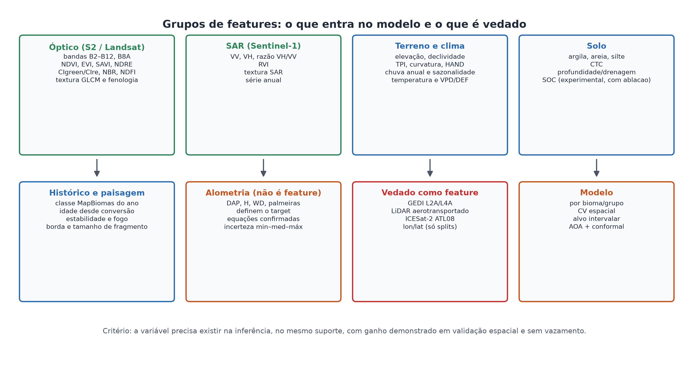
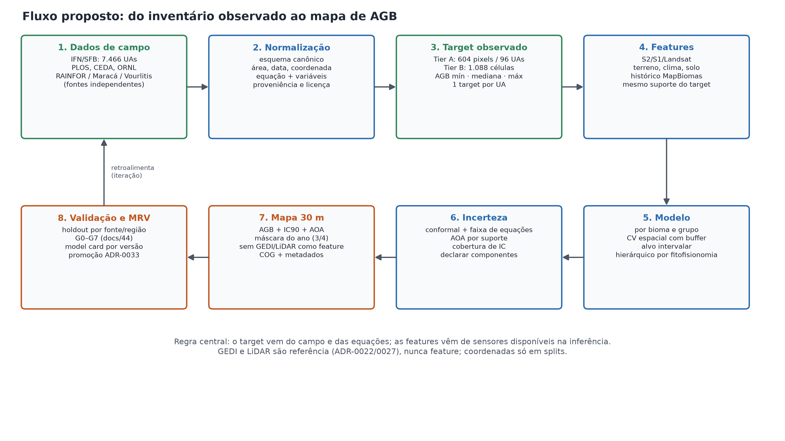
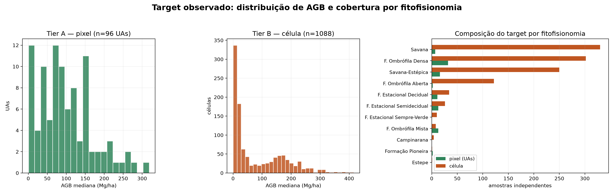

# 62 — Plano de features e abordagem (do target observado ao mapa de AGB)

**Data:** 2026-11-27 · **Status:** proposta para decisão. Complementa `docs/61` (plano do
target) e `docs/60` (enriquecimento IFN).

Artefatos desta etapa:

| Artefato | Caminho |
|---|---|
| Catálogo de features | `data/reference/features_biomassa.csv` |
| Variáveis alométricas e equações | `data/reference/alometria_alvo.csv` |
| Fluxograma | `docs/figuras/plano_1_fluxo.png` |
| Grupos de features | `docs/figuras/plano_2_features.png` |
| Target: histogramas e cobertura | `docs/figuras/plano_3_target_hist.png` |

## 1. O target atual é o indicado? (avaliação)

**O que ele é:** 96 UAs com pixels confirmados (604 pixels de 30 m) e 1.088 UAs com célula
de ~1,1 km homogênea, cada uma com AGB mín · mediana · máx entre equações. **Um target por
UA** (1.184 amostras independentes), com suporte `pixel_30m` ou `celula_1km`.

**Pontos fortes**

- É **observado e rastreável**: campo → classe/tipologia → equação → AGB, com proveniência.
- A confirmação espacial (precisão da coordenada + homogeneidade da classe) elimina
  ambiguidade de localização onde ela existe.
- A faixa mín–mediana–máx carrega a incerteza de equação, hoje o maior componente.
- O filtro é conservador: só entra o que passa em dominância, classe e plausibilidade.

**Limitações (por que ele não deve ser o único conjunto de treino)**

1. **n efetivo pequeno**: 96 UAs no Tier A e 1.088 no Tier B; os 604 pixels são
   pseudo-réplicas de 96 valores.
2. **Viés de seleção**: só UAs com precisão ≥2 casas, classe homogênea e plausibilidade —
   não é amostra representativa do domínio.
3. **Cobertura espacial desigual**: Tier A concentrado em 13 UFs; Tier B em 25, mas com
   classes desbalanceadas (Savana 330, FOD 302, Savana-Estépica 250; várias com <35).
4. **Suporte misto**: pixel de 30 m e célula de 1,1 km não são o mesmo alvo; exige modelo
   em dois estágios (ver §4).
5. **Upscaling** da célula (0,4/0,8 ha → 1,1 km) e **incerteza de equação** (faixa de 3–8×
   a mediana) precisam estar no modelo.

**Veredito:** manter o target como **âncora de alta confiança e conjunto de validação**, e
usar os **6.838 UAs elegíveis (Tier C, atributo + pegada)** como base de treino com
fitofisionomia como estrato/efeito aleatório. O Tier A/B (Tiers confirmados) calibra e
valida o modelo e permite a espacialização de alta confiança. Um modelo treinado **apenas**
nos 1.184 confirmados seria honesto, mas pequeno e enviesado.

## 2. Features recomendadas (catálogo)

Critérios: existir **na inferência**, no **mesmo suporte** do alvo, com ganho demonstrado em
validação espacial e sem vazamento. Catálogo completo em `data/reference/features_biomassa.csv`
(com prioridade e status ADR).

| Grupo | Features principais | Literatura | Prioridade |
|---|---|---|---|
| Óptico S2 | bandas B2–B12/B8A; NDVI, EVI, SAVI, NDRE, CIgreen/CIre, NBR, NDFI; textura GLCM; fenologia | alta | 1 |
| Óptico Landsat | bandas/índices anuais (série histórica e legado) | alta | 2 |
| SAR S1 | VV, VH, VH/VV, RVI, textura, série anual | alta | 1 |
| Terreno | elevação, declividade, aspecto, TPI, curvatura, HAND | alta | 1–2 |
| Clima | chuva anual, sazonalidade, temperatura, VPD/DEF | alta | 1–2 |
| Solo | argila, areia, silte, CTC, profundidade/drenagem | alta | 1–2 |
| Histórico | classe MapBiomas do ano, idade desde conversão, estabilidade, fogo | alta | 1–2 |
| Paisagem | distância à borda, tamanho do fragmento, densidade de borda | média | 2–3 |
| **Vedado como feature** | GEDI L2A/L4A, LiDAR aerotransportado, ICESat-2; lon/lat | — | 0 |

**Regras:** GEDI e LiDAR são referência de calibração/avaliação (ADR-0022/0027), nunca
feature; coordenadas só em splits; SOC apenas experimental com ablação e checagem de
circularidade (ver resposta sobre solo). S1 é o complemento natural de S2 em dossel denso e
nuvem; textura e fenologia são os blocos com maior ganho documentado em florestas tropicais.

## 3. Alometria: as variáveis das equações também são parte do modelo

O target não nasce do nada: ele é `f(DAP, H, WD, palmeiras)` via equações. O catálogo
`data/reference/alometria_alvo.csv` registra:

| Variável | Unidade | Papel | Disponibilidade |
|---|---|---|---|
| DAP | cm | variável primária de todas as equações | campo (IFN não publica árvore-a-árvore) |
| Altura total (H) | m | Chave 2014 e equações locais | campo; estimar por H–DBH quando ausente e marcar |
| Densidade da madeira (WD) | g/cm³ | obrigatória na Chave 2014 | não publicada; usar GWDD/TRY por gênero e declarar |
| Palmeiras | ind./ha | equação própria (Goodman 2013) | campo |
| Área da parcela | ha | converte biomassa total em Mg/ha | parcial (bloqueio do RAINFOR) |

**Equações confirmadas no target** (SFB, selecionadas por bioma×tipologia) ficam registradas
em `agb_equacao`; para novas bases, usar **um protocolo único** (Chave 2014 + WD local +
H medida/estimada) e registrar a equação e as variáveis usadas em cada observação. Nunca
aplicar equação específica de uma parcela em outra sem checar domínio (DAP, tipologia).

## 4. Abordagem recomendada

**Dois estágios, com validação espacial e alvo intervalar:**

1. **Estágio 1 (1 km / célula):** modelo AGB ~ features no suporte da célula (S2/S1 anuais,
   clima, solo, histórico) com os 6.838 UAs elegíveis e fitofisionomia como efeito aleatório
   ou estrato; alvo = mediana (com faixa min–máx como peso/intervalo); CV por blocos
   espaciais com buffer e leave-one-source-out.
2. **Estágio 2 (30 m):** downscaling com features de alta resolução, calibrado e validado
   pelos **Tier A** (604 pixels) e pelos Tier B; AOA e conformal por célula.
3. **Incerteza:** conformal por fold + faixa de equações + componentes declarados
   (referência, alometria, modelo, máscara); cobertura de IC90 por estrato e por polígono.
4. **Validação:** holdout de campo independente (Maracá/RAINFOR/PLOS/ORNL/CEDA), por região
   e por fonte; comparação com A0 sob o mesmo protocolo; promoção só via ADR-0033.

**Por que não um único modelo global de 30 m agora?** Porque o target confirmado em 30 m é
pequeno (96 UAs) e a incerteza de colocação/equação domina; o modelo em dois estágios usa
todo o campo disponível no suporte em que ele é confiável e só desce a 30 m onde há
evidência (Tier A) e AOA.

## 5. Benchmarks: Chloris e Kanop (o que fazem e onde podemos superar)

- **Chloris Geospatial:** mapas globais de AGB a partir de fusão multissensor (óptico, SAR,
  LiDAR) com calibração por campo e aprendizado de máquina, com foco em incerteza e uso em
  mercados de carbono.
- **Kanop:** plataforma de MRV para projetos de carbono, combinando parcelas de campo,
  LiDAR e satélite em modelos de AGB/carbono, com foco em escala de projeto e verificação.

**Nossos diferenciais no Brasil:** base IFN nacional (7.466 UAs) com desenho amostral
documentado; fitofisionomia IBGE e classes MapBiomas; dados legados brasileiros (RADAM/
PRONASOLOS) e campanhas nacionais (Paisagens Sustentáveis); equações locais e a matriz de
equações auditada; target em tiers com confirmação espacial e três valores de AGB; e
portões MRV (docs/44) desde o desenho. O que eles têm e precisamos construir: automação
operacional, cobertura wall-to-wall e ciclos de atualização.

## 6. Plano de experimentos (após definir features e target)

| Exp. | Pergunta | Desenho | Critério |
|---|---|---|---|
| E3 | baseline por estrato vs RF | média por fitofisionomia; RF com S2 | RMSE/viés, R² |
| E4 | ganho de SAR/textura/fenologia | ablação por grupo | ganho em CV espacial |
| E5 | dois estágios 1 km→30 m | estágio 1 + downscaling | erro no Tier A |
| E6 | incerteza | conformal, quantílico | cobertura IC90 por estrato |
| E7 | validação externa | Maracá/RAINFOR/PLOS/ORNL | erro por fonte/região |

## 7. Leitura do target atual (dados reais)

- Tier A (96 UAs): mediana de AGB concentrada entre 20–160 Mg/ha, com cauda até ~320.
- Tier B (1.088): distribuição assimétrica à direita (Savana/estépica em valores baixos;
  florestas até ~400).
- Cobertura por fitofisionomia é suficiente para Savana, FOD e Savana-Estépica; insuficiente
  para Estepe, Pioneira, Campinarana e FOM.

## 8. Riscos e decisões pendentes

1. **Equação**: manter a mediana ou modelar a faixa? Recomendo alvo intervalar.
2. **Suporte**: treinar em 1 km e descer a 30 m, ou treinar direto em 30 m com pseudo-réplicas?
   Recomendo dois estágios.
3. **SOC**: só experimental, com ablação e checagem de circularidade.
4. **GEDI/LiDAR**: só referência; se um dia entrarem como feature, exigirá revisão de ADR.
5. **Bases externas**: RAINFOR bloqueado por área; Maracá/Vourlitis pendentes de download.

## 9. Próximos passos imediatos

1. Consolidar o target por UA (1.184) e rasterizar no suporte das features.
2. Calcular o cubo de features por grupo (S2, S1, terreno, clima, solo, histórico) no
   mesmo suporte, com máscara do ano.
3. Rodar E3/E4 com CV espacial e curva de aprendizado.
4. Ingerir Maracá (quando o arquivo estiver em `data/raw`) e RAINFOR (após área).
