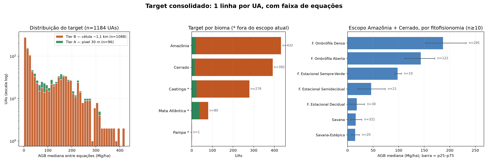

# 63 — Target consolidado por UA (execução de 2026-11-27)

**Status:** executado e verificado. Complementa `docs/61` (plano do target) e `docs/62`
(plano de features). Decisão de arquitetura em `ADR/0034`.

## 1. O que foi consolidado

Uma linha por **unidade amostral (UA)**, a partir das camadas `pixels_confirmados` e
`celulas_confirmadas` de `ifn_candidatos_espaciais.gpkg`:

- Tier A (pixel 30 m): 604 pixels → **96 UAs**;
- Tier B (célula ~1,1 km): **1.088 UAs**;
- total: **1.184 UAs**, sem sobreposição entre tiers e sem conflito de valores;
- `agb_mg_ha` = mediana entre equações; `agb_min_mg_ha`/`agb_max_mg_ha` = faixa;
- `n_repeticoes` preserva os pixels-irmãos (nunca contados como amostras independentes);
- coordenadas (`lon`/`lat`) são metadados de split/mapa, **não** features.

Comando:

```bash
python -m biomass_model.cli target-consolidate \
  --gpkg data/processed/ifn_enrich_footprint/ifn_candidatos_espaciais.gpkg \
  --out-csv data/processed/target/target_uas.csv \
  --out-gpkg data/processed/target/target_uas.gpkg \
  --manifest data/processed/target/target_manifest.json
```

Para o escopo atual:

```bash
python -m biomass_model.cli target-consolidate \
  --gpkg data/processed/ifn_enrich_footprint/ifn_candidatos_espaciais.gpkg \
  --out-csv data/processed/target/target_uas_amazonia_cerrado.csv \
  --manifest data/processed/target/target_manifest_amazonia_cerrado.json \
  --biomes "Amazonia,Cerrado"
```

Artefatos (fora do Git por `.gitignore`; hashes permitem verificar a regeneração):

| Artefato | Linhas | SHA-256 |
|---|---:|---|
| `target_uas.csv` (todos os biomas) | 1.184 | `9bb951766f49827e30f0b1e8770aa87b20b2771a4d96b5ef61de4e47004ea9ab` |
| `target_uas_amazonia_cerrado.csv` | 824 | `349279af995e7783f45636127ba9d82a4a6d20ac06b4919b86be06672de485fc` |
| `target_uas.gpkg` (pontos, EPSG:4326) | 1.184 | `0ccec5904049ecc68afcca5619644211aaac6a776fbe17d0717bf0c6ceeb8b64` |



## 2. Cobertura e distribuição

| Conjunto | UAs | Tier A | Tier B | AGB p25 | AGB p50 | AGB p75 | AGB máx |
|---|---:|---:|---:|---:|---:|---:|---:|
| Todos os biomas | 1.184 | 96 | 1.088 | 10,6 | 38,2 | 153,9 | 415,6 |
| **Amazônia + Cerrado** | **824** | **36** | **788** | 16,7 | **81,1** | 171,8 | 415,6 |
| Fora do escopo (Caatinga, MA, Pampa) | 360 | 60 | 300 | — | — | — | — |

**Achado que muda o planejamento:** dos 96 UAs do Tier A, apenas **36** estão em
Amazônia/Cerrado; 60 estão em Caatinga/Mata Atlântica. O “âncora de 30 m” no escopo é,
portanto, **menor do que o número bruto sugere**. Isso reforça o modelo em dois estágios:
o estágio 1 usa as 824 UAs (788 em 1,1 km) e o downscaling para 30 m depende de poucas
UAs de alta confiança, de validação independente e de AOA — não de pseudo-réplicas.

Por bioma (todos os biomas): Amazônia 432, Cerrado 392, Caatinga 279, Mata Atlântica 80,
Pampa 1.

Por fitofisionomia no escopo (n ≥ 10):

| Fitofisionomia | n | AGB p50 (Mg/ha) |
|---|---:|---:|
| Floresta Ombrófila Densa | 295 | 186,7 |
| Floresta Ombrófila Aberta | 122 | 143,2 |
| Floresta Estacional Sempre-Verde | 10 | 97,9 |
| Floresta Estacional Semidecidual | 21 | 46,2 |
| Floresta Estacional Decidual | 30 | 18,1 |
| Savana | 321 | 15,8 |
| Savana-Estépica | 20 | 14,9 |

Sem suporte suficiente (n < 10): Campinarana (4), Formação Pioneira (1). No escopo, não há
Estepe nem Floresta Ombrófila Mista.

## 3. Catálogo de features: contrato executável

```bash
python -m biomass_model.cli features-catalog \
  --catalog data/reference/features_biomassa.csv --max-priority 1
```

- catálogo: **56 features**; prioridade 1: **27**;
- `feature_set_hash` (prioridade 1): `205c859fb82c27749c5451321d35af19a46f5d3ac3c2513eea65683e232c78c4`;
- com experimentais (SOC), excluindo apenas as vedadas: 52 features,
  hash `57ce5ce4d8ea33f016b6f5d80453d2264e1bf9a123c4b9c5b7f4f3c97e62ef67`;
- exclusões permanentes: GEDI L2A/L4A, LiDAR aerotransportado, ICESat-2 ATL08 e lon/lat
  (`vedada_como_feature`, prioridade 0);
- SOC (`carbono organico do solo`) é `permitida_experimental`: só entra com
  `--include-experimental`, para ablação e checagem de circularidade.

Grupos no conjunto prioridade 1: Óptico S2 (10), Índices S2 (4), SAR S1 (4), Clima (3),
Solo (2), Terreno (2), Histórico (2).

## 4. Guardrails verificados por teste

`tests/test_targets.py` e `tests/test_feature_catalog.py` (12 testes novos) cobrem:

- 1 linha por UA, com contagem de UAs únicas;
- precedência Tier A sobre Tier B em conflito;
- `min ≤ mediana ≤ max` e recusa de intervalo inconsistente;
- valores de AGB constantes dentro da UA (pixels-irmãos não divergem);
- plausibilidade (mediana > 0 e ≤ 500 Mg/ha), com registro do que foi removido;
- nenhuma coluna com GEDI/LiDAR/ICESat no target;
- CSV, GeoPackage e manifesto com SHA-256 reprodutível;
- catálogo: status válido, prioridade 0 apenas para vedadas, seleção por grupo/prioridade,
  hash independente da ordem e opt-in para experimental.

## 5. Limitações declaradas

1. **Suporte misto:** 30 m (36 UAs no escopo) e ~1,1 km (788) não são o mesmo alvo; o
   treino deve declarar o suporte e validar separadamente por tier.
2. **Upscaling:** a célula de 1,1 km agrega uma pegada de 0,4/0,8 ha; a posição exata da
   pegada dentro da célula é incerta (`hipotese` da camada de origem).
3. **Incerteza de equação:** a faixa min–max chega a 50–80× a mediana em alguns casos
   (`spread_razao`); o alvo intervalar é obrigatório no relatório.
4. **Sem validação independente ainda:** o target é observado e rastreável, mas o modelo
   que o espacializa ainda não foi treinado/validado; nada aqui é MRV.
5. **Biomas fora do escopo** ficam no catálogo canônico (transparência e reuso), mas não
   devem entrar no treino de Amazônia/Cerrado sem decisão explícita.
6. **Valores ausentes não são zero:** `fracao_coberta_media` é NaN no Tier B (não há pixel)
   e `ibge_share_compativel` é NaN quando não houve interseção com o IBGE.

## 6. Próximo passo

Calcular o cubo de features no mesmo suporte (30 m e ~1,1 km) para uma amostra de UAs,
começando pelo conjunto prioridade 1 e pelo `feature_set_hash` registrado; em seguida,
E3 (baseline por estrato vs RF) com blocos espaciais + buffer e curva de aprendizado.
