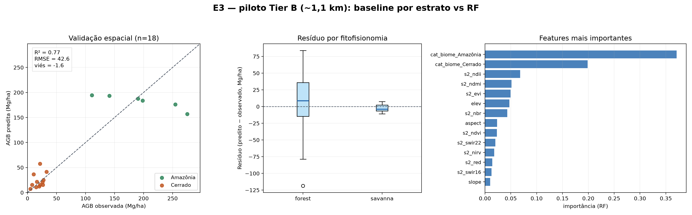

# 65 — Piloto de features e E3 no Tier B (2026-11-27)

**Status:** executado como piloto de pipeline; **não é validação operacional**. Os
números servem para decidir onde investir, não para afirmar acurácia do produto.

## 1. Desenho

- Target: Tier B (~1,1 km), 60 UAs sorteadas com semente 42 (31 Amazônia / 29 Cerrado).
- 58 UAs ficaram utilizáveis; 2 (`MT_295`, `RO_75`) não tinham cena S2 em ±2 anos.
- Composição final: 28 floresta amazônica, 1 savana amazônica, 3 floresta do Cerrado,
  26 savana do Cerrado.
- Features (26 colunas): S2 (6 bandas + NDVI, NDMI, NDII, NBR, EVI, NIRv, fração válida),
  terreno (elevação, declividade, aspecto), histórico MapBiomas (classe e 5 métricas de
  histórico) e categóricas de bioma/grupo.
- `feature_columns_hash`: `d85879e376ad8fd145b02835f2ddf3724b1a316d7bc01da87fe8f28f2aca953c`.
- Não entraram: S1, clima, solo, textura, fenologia S2 e fitofisionomia IBGE.

Comandos:

```bash
python -m biomass_model.cli target-observations \
  --target-csv data/processed/target/target_uas_amazonia_cerrado.csv \
  --out data/processed/features/sample_obs.csv \
  --manifest data/processed/features/sample_obs_manifest.json \
  --tier B --sample 60 --seed 42 --by bioma

python tools/fetch_target_features.py \
  --observations data/processed/features/sample_obs.csv \
  --out-dir data/processed/features/rasters --size 128

python -m biomass_model.cli features-observations \
  --observations data/processed/features/sample_obs_ready.csv \
  --out data/processed/features/features_ready.csv \
  --optical-dir data/processed/features/rasters/s2 --optical-pattern "{site}.tif" \
  --dem-dir data/processed/features/rasters/dem --dem-pattern "{site}.tif" \
  --mapbiomas-dir "<Mapbiomas_Uso_do_Solo>" \
  --half-m 500 --history-start 2007 --history-end 2025
```

## 2. Resultados

Validação espacial por blocos com buffer (mesmo protocolo para modelo e baseline):

| Configuração | n teste | R² | RMSE | viés | baseline R² | baseline RMSE | IC90 cobertura | IC90 largura |
|---|---:|---:|---:|---:|---:|---:|---:|---:|
| 200 km / 25 km, com bioma | 18 | **0,774** | 42,6 | −1,6 | 0,323 | 73,8 | 0,78 | 126,3 |
| 100 km / 10 km, com bioma | 19 | 0,747 | 51,9 | −12,8 | 0,530 | 70,8 | 0,79 | 190,4 |
| 200 km / 25 km, **sem bioma** | 18 | 0,721 | 47,3 | +0,6 | 0,323 | 73,8 | 0,72 | 134,1 |

Por grupo (configuração 200/25):

| Estrato | n | R² | RMSE |
|---|---:|---:|---:|
| floresta | 9 | 0,599 | 59,9 |
| savana | 9 | 0,311 | 6,3 |
| Amazônia | 6 | **−0,507** | 71,0 |
| Cerrado | 12 | **−2,033** | 14,2 |



## 3. Leitura honesta

1. **O modelo bate o baseline** sob o mesmo protocolo: RMSE 42,6 vs 73,8 na configuração
   principal; R² 0,77 vs 0,32.
2. **Mas o ganho é sobretudo entre biomas.** O R² within-bioma é negativo (Amazônia −0,51;
   Cerrado −2,03), e a figura mostra previsões quase constantes dentro de cada bioma. As
   categóricas de bioma dominam a importância (0,37 + 0,20).
3. **Sem a categórica de bioma**, o R² cai para 0,721 e as features espectrais assumem:
   NBR (0,16), NDII (0,16), NDMI (0,16), EVI (0,08), SWIR2 (0,07), elevação (0,06).
   Isso mostra sinal espectral real, mas ainda insuficiente para ranquear bem dentro do
   bioma.
4. **A incerteza está subdimensionada:** cobertura do IC90 de 0,72–0,79 contra 0,90
   nominal, com largura de 126–190 Mg/ha. Conformal com n=18–19 é instável.
5. **Não é validação independente:** o teste é espacial, mas usa a mesma fonte (IFN) e o
   mesmo target; não há holdout de outra fonte.

## 4. Limitações do piloto

- 58/60 UAs, duas sem S2; amostra pequena e desbalanceada (1 savana amazônica).
- S2 de **uma data**: 50 UAs no ano do inventário, 1 em +1 ano, 5 em +2 anos e 2 sem ano
  registrado; não há fenologia nem composição multi-temporal.
- Suporte de 1 km: a AGB medida em 0,4/0,8 ha é upscalada; a posição da pegada na célula
  é incerta.
- Sem S1, clima, solo, textura ou fitofisionomia IBGE; sem Tier A (30 m).
- O alvo intervalar (min–max entre equações) não foi propagado para a incerteza do modelo.

## 5. Implicações para o plano

1. **Prioridade 1:** adicionar S1 (VV/VH), textura e fenologia S2; são os blocos com maior
   chance de capturar variação dentro do bioma.
2. **Prioridade 2:** rodar a ablação completa (S2 apenas; S2+terreno; S2+histórico;
   todos) e um teste **leave-one-biome-out** para medir transferência de domínio.
3. **Prioridade 3:** repetir com mais UAs (as 788 Tier B) e com o Tier A (36 no escopo)
   para o downscaling.
4. A curva de aprendizado exploratória **não foi conclusiva**: o modo de CV muda com o
   tamanho amostral (blocos espaciais falham em n pequeno). Refazer com partições fixas.

## 6. Arquivos

- Amostra: `data/processed/features/sample_obs.csv` (60) e `sample_obs_ready.csv` (58).
- Features: `features_ready.csv` e `features_ready_prov.csv` (com ano/nuvem do S2).
- E3: `data/processed/features/e3_58_200km.*`, `e3_58_100km.*`, `e3_58_nobiome.*`.
- Figura: `docs/figuras/e3_piloto_58.png`.
- Ferramentas: `tools/fetch_target_features.py`, `tools/plot_e3_results.py`,
  `tools/learning_curve.py`.
